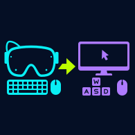

# Frame Input



**Use the USB keyboard and mouse plugged into your Steam Frame on your streamed Windows PC.**

Frame Input adds simple Start/Stop and Use/Return shortcuts around [VirtualHere](https://www.virtualhere.com/). The receiver stays plugged into the headset; VirtualHere carries its USB connection over your home network to Windows. Your existing Steam/SteamVR connection continues to handle video.

**Public alpha: 0.1.3-alpha.** The original tester confirmed keyboard/mouse forwarding, return to local Frame input, and working shortcuts on both Windows and Frame. This is one setup, not a compatibility guarantee. See the [test record and remaining checks](ACCEPTANCE.md).

## Get started

Download **[frame-input-0.1.3-alpha.zip](https://github.com/uxandy/frame-input/releases/download/v0.1.3-alpha/frame-input-0.1.3-alpha.zip)** from the [release page](https://github.com/uxandy/frame-input/releases/tag/v0.1.3-alpha). Extract a copy on Windows and on the Frame. You do not need Git or a compiler.

Then follow the **[step-by-step setup guide](docs/setup.md)**. It covers downloading VirtualHere, identifying your USB receiver, installing the Frame service, creating Windows shortcuts, and adding Start/Stop to the Frame's Steam Library. VirtualHere is downloaded separately; its executables and drivers are not bundled.

Already have a working installation? Read [updating and removal](docs/maintenance.md) first. This release keeps the runtime scripts from 0.1.2; a working installation does not need reinstalling just to get these docs.

## Daily use

| Where | Action | What happens |
| --- | --- | --- |
| Frame | **Frame Input - Start Sharing** | Starts the USB server. The receiver remains local until Windows claims it. |
| Streamed Windows desktop | **Use Frame Keyboard & Mouse** | Starts/reuses the Windows client and requests your saved receiver. |
| Windows | **Return to Frame** | Releases the receiver for local use. The server stays available. |
| Frame | **Frame Input - Stop Sharing** | Stops the server, ending USB sharing. |

Plug the receiver into the Frame before starting. Start Sharing locally before beginning your stream for the first test. Use the VR controllers to operate the Windows shortcuts when the keyboard/mouse are still local.

Sharing runs **until you stop it** by default. It does not start at boot or detect the end of a SteamVR stream. Closing the launcher's dialog also leaves the server running. An optional installation setting provides a session timer.

## What you need

- An ARM64 Steam Frame with desktop/terminal access, a sudo password, Python 3, systemd, and zenity or kdialog. SSH from another computer is useful for setup and recovery, but you can use the Frame desktop terminal.
- A USB OTG adapter and an external USB receiver that already works with the keyboard and mouse locally on Frame. The initial test used a combined receiver.
- An x64 Windows gaming PC with Windows PowerShell 5.1 and VirtualHere's `vhui64.exe` client. The helper targets Windows 10/11 x64; Windows ARM64 is not supported by this helper's executable picker.
- A trusted home network connecting both machines. The generic VirtualHere trial currently supports one shared USB device without a time limit. This helper selects one receiver; separate keyboard/mouse USB devices need a different workflow and may need a vendor license. Check [VirtualHere's current terms](https://www.virtualhere.com/usb_server_software).

## Recover or troubleshoot

Release held keys/buttons, then use **Return to Frame** or VirtualHere's **Stop Using**. If Windows is unavailable, use **Stop Sharing** on Frame or run this in a Frame terminal/SSH session:

```sh
sudo /usr/bin/systemctl stop frame-input.service
```

Once the service is stopped, reconnect only the external receiver if local input has not returned. Keep an independent way to run Stop available during your first test.

See [troubleshooting](docs/troubleshooting.md) for an empty receiver list, sudo prompts, connection problems, changed addresses, and shortcut conflicts.

## Scope and limits

The Frame service is installed with root-owned files and passwordless permission for only its exact Start/Stop commands. The Windows helper saves one selected receiver and does not enable global Auto-Use. The allowlist identifies a USB vendor/product model, not a unique physical receiver.

This configuration uses ordinary TCP on port 7575 without authentication or encryption. Use it only on a trusted LAN; do not expose it through router port forwarding. The utility adds no pairing or firewall rules. See [security and installed files](SECURITY.md).

There is no dashboard overlay, automatic stream detection, or SteamOS input patch. In-stream shortcut focus, abnormal disconnects, stuck modifiers, reboot behavior, and sustained gameplay still need dedicated testing. We make no latency, anti-cheat, or universal USB compatibility claim.

## Documentation and development

- [Full setup](docs/setup.md)
- [Troubleshooting and recovery](docs/troubleshooting.md)
- [Updating, uninstalling, and manual fallback](docs/maintenance.md)
- [Test record](ACCEPTANCE.md)
- [Changelog](CHANGELOG.md)
- [Contributing and running tests](CONTRIBUTING.md)

The wrapper code and included illustration are [MIT licensed](LICENSE). VirtualHere is separate proprietary software with its own terms. Frame Input is an independent community utility and is not affiliated with Valve or VirtualHere.
